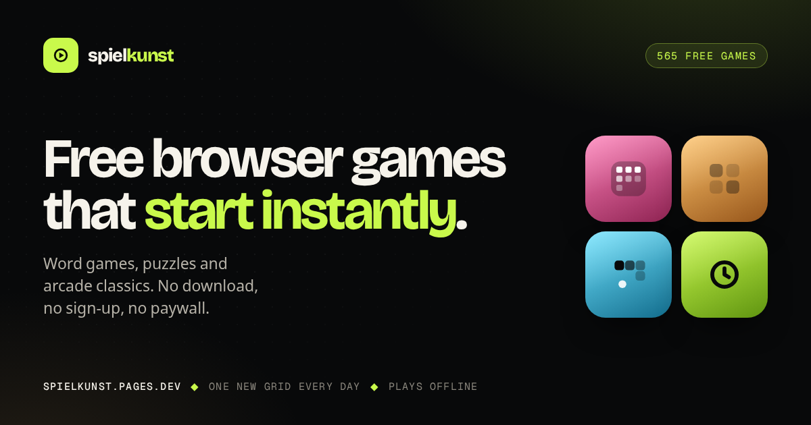
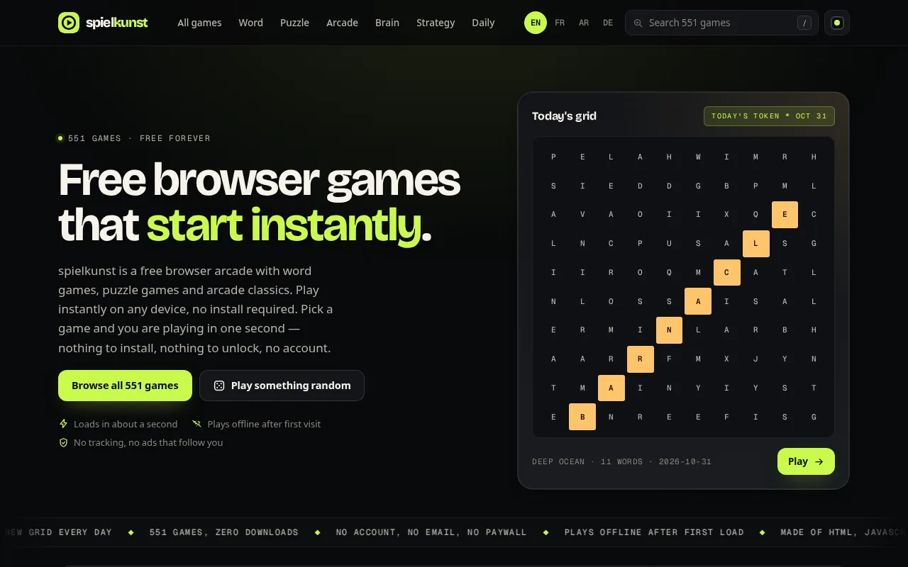
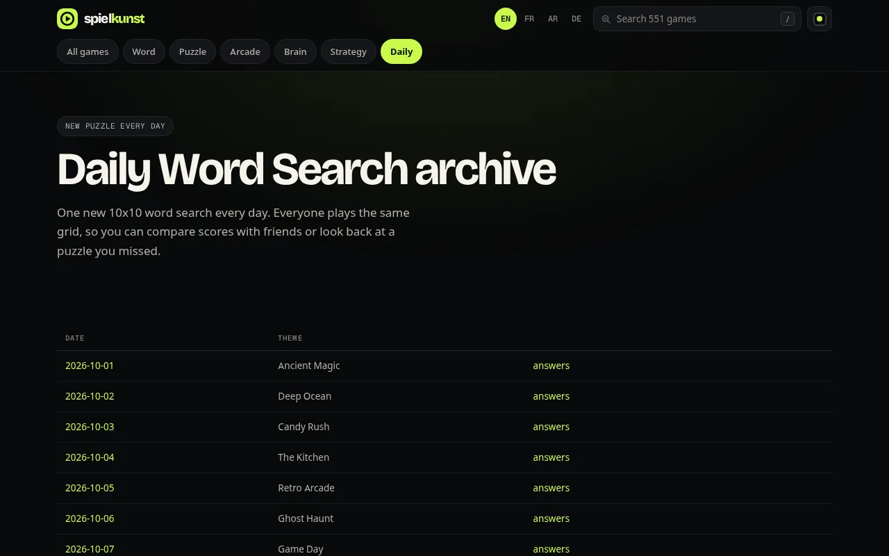
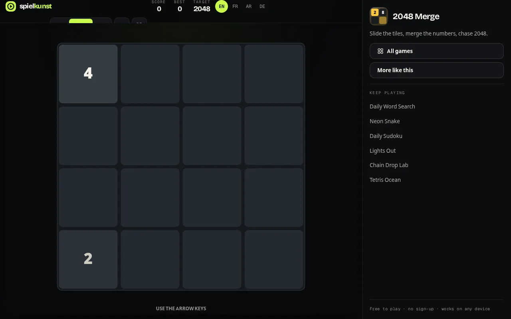
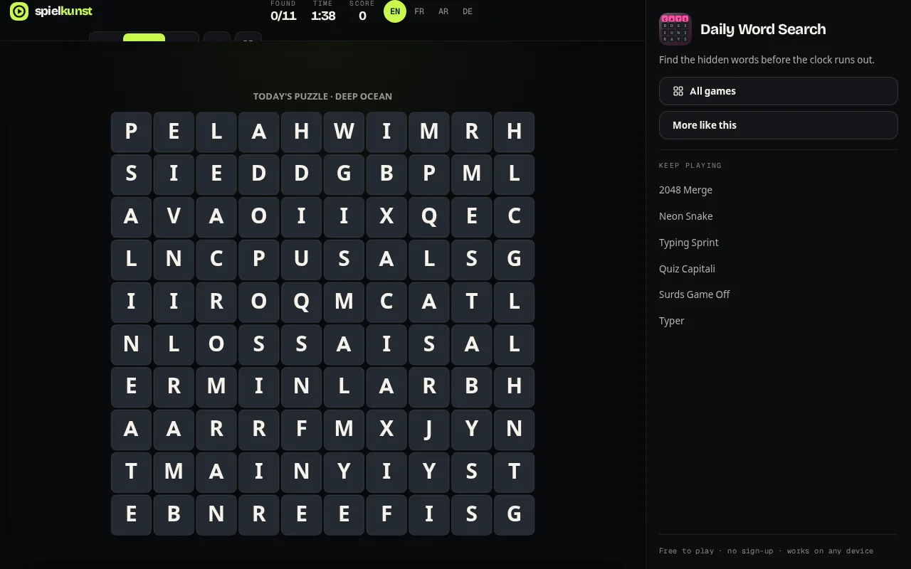
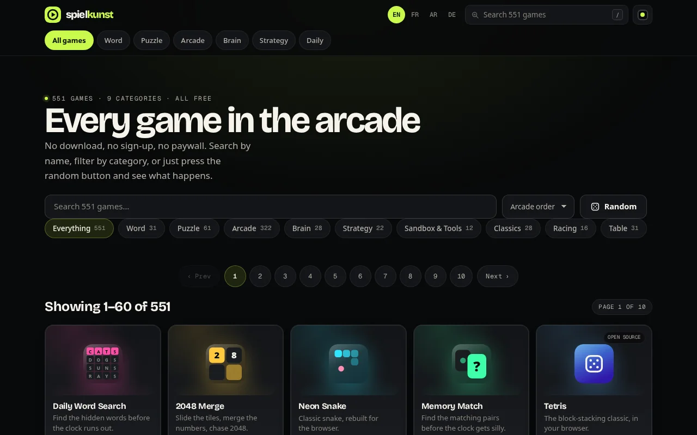
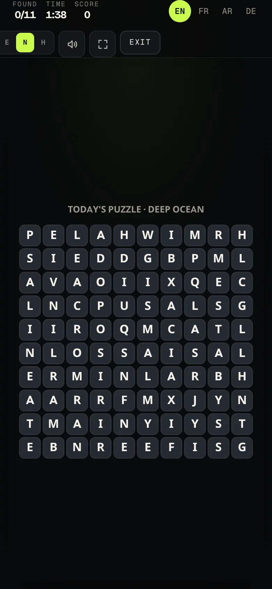

<p align="center">
  <a href="https://spielkunst.pages.dev/"></a>
</p>

<h1 align="center">spielkunst</h1>

<p align="center">
  <strong>551 free browser games that start instantly.</strong><br>
  No download. No account. No paywall. No ads before you play.
</p>

<p align="center">
  <a href="https://spielkunst.pages.dev/"><b>▶ Play now — spielkunst.pages.dev</b></a>
  &nbsp;·&nbsp;
  <a href="https://ayhemkahridev.github.io/">mirror</a>
</p>

## A look around

| Home | Today's puzzle |
| --- | --- |
| [](https://spielkunst.pages.dev/) | [](https://spielkunst.pages.dev/daily/) |

| 2048 | Word search |
| --- | --- |
| [](https://spielkunst.pages.dev/games/merge/) | [](https://spielkunst.pages.dev/games/wordsearch/) |

| All games | On a phone |
| --- | --- |
| [](https://spielkunst.pages.dev/games/) | [](https://spielkunst.pages.dev/games/wordsearch/) |

## What it is

**spielkunst** is a free browser arcade: word games, puzzle games, arcade classics and
daily challenges, in English, French, Arabic and German. Pick a game and you are playing
in about a second — nothing to install, nothing to unlock, no account.

- **551 games in 9 categories** — 10 built on the spielkunst engine, 541 open-source
  games vendored with their original licences.
- **One new daily puzzle** at midnight UTC: word search, sudoku, and more — with a full
  archive so you can replay old grids or look up the answers.
- **Phone first.** Every game is playable with one thumb; games that need keys get an
  on-screen pad.
- **Offline after first visit.** The whole page is static HTML, CSS and JavaScript;
  a service worker keeps it playable without a network.

## Zero running cost

This is a static site, full stop. No server, no database, no paid API, no external
service at runtime — the site does not `fetch()` anything it does not own.

- Hosted on **Cloudflare Pages** free tier: <https://spielkunst.pages.dev/>
- Mirrored on **GitHub Pages** as the fallback: <https://ayhemkahridev.github.io/>
- Built output: **622.5 MB across 18,131 files** (`npm run audit:size`), served from one
  CDN edge, so a cold visit costs only the page it asks for.
- Engine bundle: **75.45 kB raw / 24.95 kB gzipped** (`vite build`).

## Run it locally

```bash
npm ci                 # install exactly what the lockfile pins
npm run dev            # vite dev server
npm run build          # -> dist/ (static site)
npm run serve:dist     # preview dist/ on http://127.0.0.1:4178
npm test               # 275 node:test cases, no browser
npm run audit          # content, links, embeds, assets, size, live game health
npm run smoke          # headless-chrome smoke test of every page and game
```

## How it works

The catalogue is five JSON layers merged by id, overlays last; a harvest pipeline vendors
open-source games, validates that each one actually plays, and blocks the ones that do
not. The daily puzzle is a pure function of the date (`src/shared/daily.js`), so every
player gets the same grid and the archive is just the past inputs.

- **[docs/HARVEST.md](docs/HARVEST.md)** — how a game gets into the catalogue, end to end.
- **[docs/ENGINEERING.md](docs/ENGINEERING.md)** — architecture, deployment, SEO,
  sustainability and audit history (moved out of this README to keep the front page a
  product page).
- **[AGENTS.md](AGENTS.md)** — the product rules any change must respect.

## Add a game

Vendored games are open-source projects that already run in a browser, credited to their
authors. Ten engine games are written here. Both paths, and the validation a game must
pass before it is published, are documented in **[docs/HARVEST.md](docs/HARVEST.md)**.

## Credits & licences

The 541 vendored games keep their original licences and authors — see
**[THIRD-PARTY-MANIFEST.md](THIRD-PARTY-MANIFEST.md)** and the
[credits page](https://spielkunst.pages.dev/credits/). The spielkunst engine, catalogue
and site code are this project's own work.

**No tracking, no accounts, no ads before a game.** Free forever.
