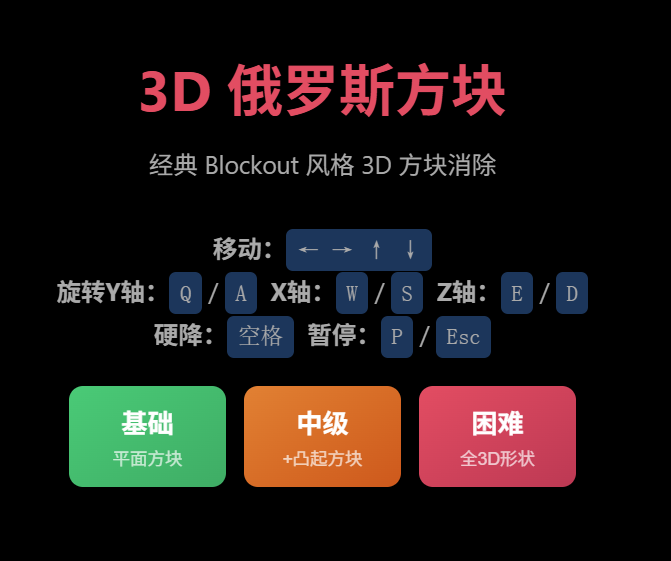
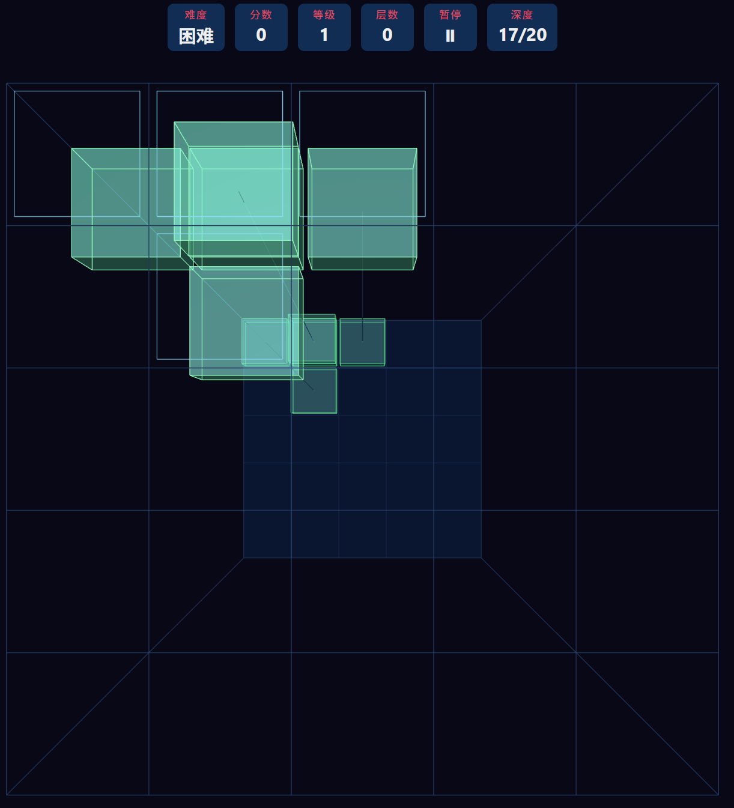

# 🎮 3D 俄罗斯方块 | Tetris 3D

**经典 Blockout 风格 3D 方块消除游戏 — 开源、无广告、零权限、极小体积**

[](LICENSE)
[](https://github.com/msfefjiang/tetris3d/releases/latest)
[](#)

<p align="center">
  <a href="https://msfefjiang.github.io/tetris3d/">🕹️ <b>点击在线试玩 Play Online</b></a>
  &nbsp;&nbsp;|&nbsp;&nbsp;
  <a href="https://github.com/msfefjiang/tetris3d/releases/latest">📱 <b>下载安卓 APK</b></a>
</p>

---

<p align="center">
  
  &nbsp;&nbsp;
  
</p>

---

## ✨ 特色 | Features

| | |
|---|---|
| 🚫 **无广告** | 纯净游戏体验，没有任何广告 |
| 🔒 **零权限** | 不请求任何手机权限 |
| 📦 **极小体积** | APK 仅 3MB |
| 🌐 **开源免费** | MIT 许可证，代码完全公开 |
| 🎯 **三种难度** | 基础 / 中级 / 困难，适合所有水平 |
| 📱 **双平台** | 浏览器和安卓手机都能玩 |

## 🕹️ 在线试玩 | Play Online

**👉 [msfefjiang.github.io/tetris3d](https://msfefjiang.github.io/tetris3d/)**

无需下载，点击链接直接在浏览器中游玩！支持电脑和手机浏览器。

## 📱 安卓版 | Android

从 [Releases 页面](https://github.com/msfefjiang/tetris3d/releases/latest) 下载 APK，传到手机安装即可。

> 安装时系统可能提示"未知来源"，允许安装即可。本应用开源透明，不含任何恶意代码。

## 🎮 操作方式 | Controls

### 键盘 (网页版)

| 操作 | 按键 |
|------|------|
| 移动 | ← → ↑ ↓ |
| 旋转 Y 轴 | Q / A |
| 旋转 X 轴 | W / S |
| 旋转 Z 轴 | E / D |
| 硬降 | 空格 |
| 暂停 | P / Esc |

### 触屏 (安卓版)

| 操作 | 手势 |
|------|------|
| 移动方块 | 单指滑动 |
| 旋转 X 轴 | 点击屏幕左侧 |
| 旋转 Y 轴 | 点击屏幕中间 |
| 旋转 Z 轴 | 点击屏幕右侧 |
| 多轴旋转 | 双指滑动 |
| 硬降 | 底部按钮 |
| 暂停 | 系统返回键 |

## 🎯 难度模式 | Difficulty

- **基础** — 平面方块（经典俄罗斯方块形状）
- **中级** — +凸起方块（5 格立体形状）
- **困难** — 全 3D 形状（完全立体多连块）

## 🔧 从源码构建 | Build from Source

```bash
# 用 Android Studio 打开 android/ 目录
# Sync Gradle → Build → Build APK(s)
```

## 📄 License

[MIT](LICENSE) — 自由使用、修改和分发
