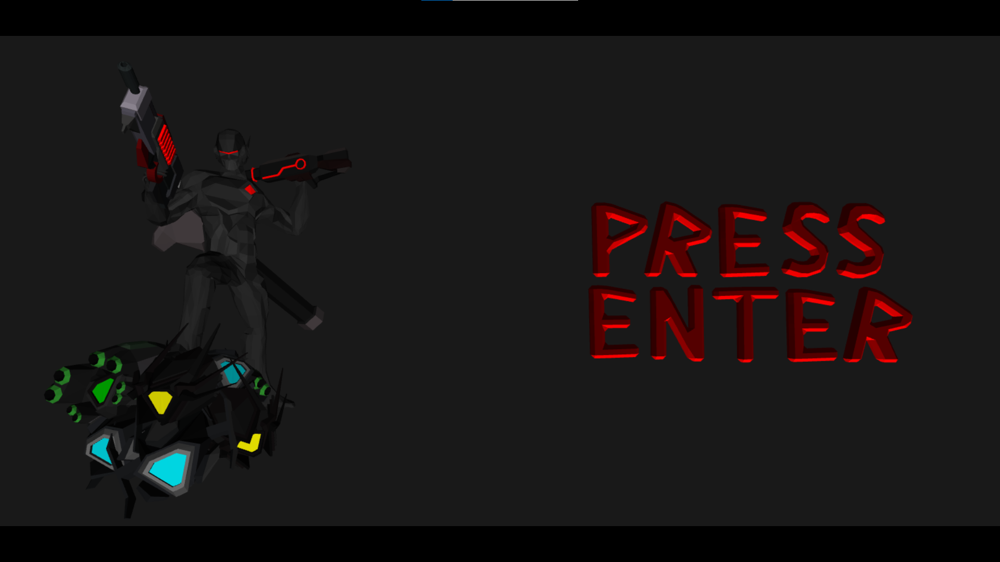
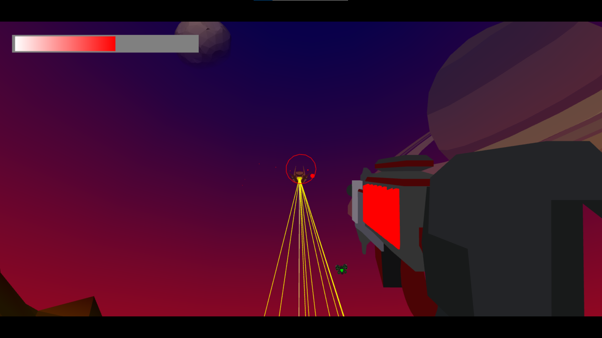
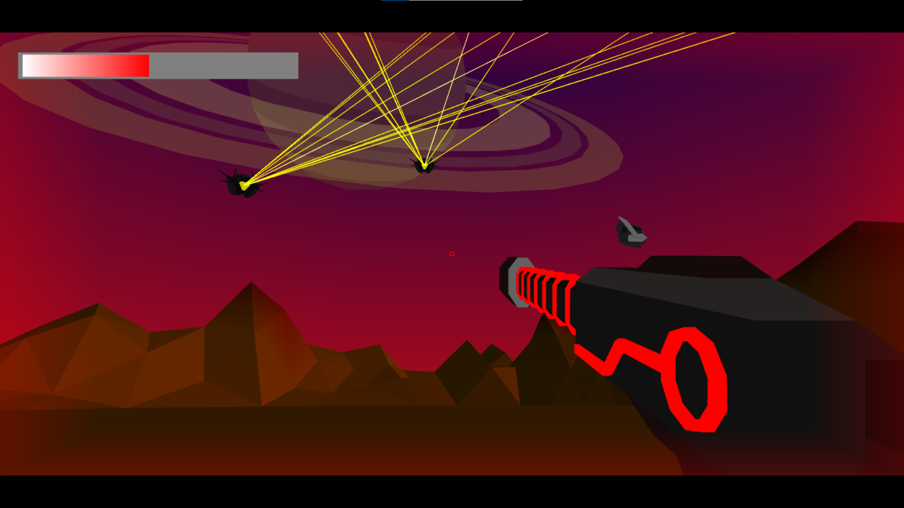
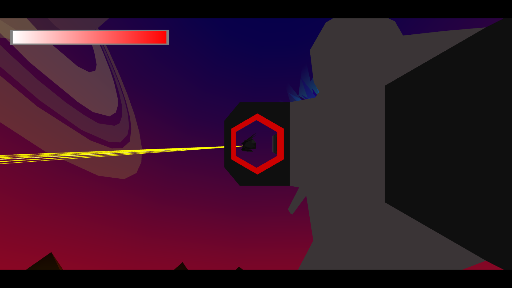
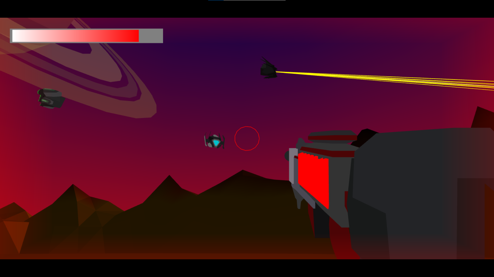

# WebGL 3D Shooter Game

A browser-based 3D shooter game built with raw WebGL and JavaScript without using external graphics libraries such as Three.js.

🔗 Play online: https://omerbilget.github.io/webgl-fps-shooter/

---

## Overview

This project demonstrates a custom 3D rendering and game logic implementation using low-level WebGL. It focuses on real-time rendering, game mechanics, and performance within the browser.

---

## Features

- Multiple weapons with different behaviors  
- Multiple enemy types with distinct attacks and visuals  
- Score tracking system  
- Runs directly in the browser (no installation required)  
- Offline support  
- Compatible with major browsers  

---

## Controls

- **W / A / S / D** – Move character  
- **Q / E** – Switch weapons  
- **Mouse Move** – Camera control  
- **Left Click** – Fire weapon  
- **F** – Toggle fullscreen  
- **L** – Enable infinite mouse movement  

---

## Screenshots

---

## Author

Omer Bilget  
https://github.com/OmerBilget
